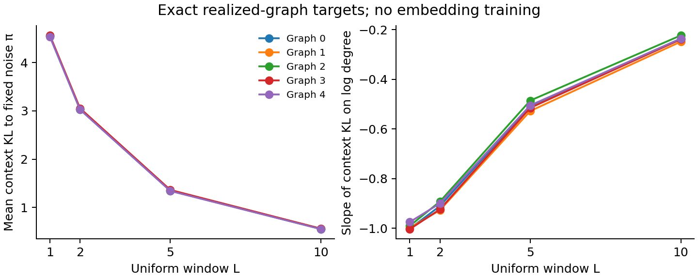

# Issue 20: population geometry, realized targets, and trained norms

Audit of [issue #20](https://github.com/govgandhi/alt_means_sans_k/issues/20)
against main commit 37d90a9a2fb5b0ef3d749ad9ee2db4fcf5f15e19.
This is a retrospective mathematical and implementation audit. The new
diagnostics train no embeddings. Historical training outputs are preserved;
PRs #35 and #36 remain separate and await review.

## Answers to the issue's three questions

1. **Yes, use three levels.** The diagonal-inclusive DCSBM proxy has
   block-constant context KL. A realized sparse graph has degree-dependent
   scores before optimization. Finite-rank factors and their optimization add
   further dependencies. The abstract and Section X now distinguish these.
   However, a degree-dependent score does **not** prove a decreasing norm, and
   exposure need not act only through transient training.
2. **Yes, check more than one block.** Exact K=1 and K=3 proxy checks now verify
   spectral radii, window contexts, block KL, balanced center rows, and the
   context log-propensity coefficient for three negative-sampling exponents.
   These validate the algebra; they are not sampled-DCSBM convergence evidence.
3. **A window diagnostic is useful and now run.** On all five existing graphs,
   windows 1, 2, 5, and 10 weaken the negative context-KL slope at fixed uniform
   center share and fixed stationary negative proposal. This supports the
   proposed diffusion effect on targets. No trained-norm or density sweep has
   been run here. Neither a universal density claim nor a norm mechanism follows.

The issue correctly identifies a missing level of explanation. Its title and
proposed assignment of one norm branch to the target and the other to training
are stronger than the evidence.

## 1. Population identities and their scope

Use the manuscript notation: block a for center i, block b for context j,
block propensity sum s_b, expected degree delta_j=theta_j kappa_b, and
block window kernel F. The exact proxy gives

$$
P^{\rm pop}_{ij}=\frac{\theta_j}{s_b}F_{ab},\qquad
\varpi_j=\frac{\theta_j\kappa_b}{\operatorname{vol}(\Omega)},\qquad
\bar\varpi_b=\frac{s_b\kappa_b}{\operatorname{vol}(\Omega)}.
$$

Summing over contexts within each block cancels the individual propensity:

$$
D(P^{\rm pop}_i\Vert\varpi)
=\sum_bF_{ab}\log\frac{F_{ab}}{\bar\varpi_b}.
$$

Thus KL is block-constant, including for finite windows. For K=1 the rows
equal varpi, KL is zero, and ordinary unigram-noise free scores equal -log k.
These statements use the manuscript's diagonal-inclusive weighted proxy.
Deleting its diagonal changes its exact low-rank structure.

The configuration experiments provide a one-block degree-heterogeneous
analogue, not literal independent-edge DCSBM samples: the generator simplifies
a configuration multigraph and connects components. Also, the issue's phrase
"all experiments" predates the manuscript's BA, Holme–Kim, and NetScience
transfer experiments.

For q_j proportional to delta_j^alpha,

$$
x^*_{ij}=H^{(\alpha)}_{ab}+(1-\alpha)\log\theta_j,\quad
H^{(\alpha)}_{ab}
=\log F_{ab}-\log s_b-\alpha\log\kappa_b
 +\log\sum_\ell\delta_\ell^\alpha-\log k.
$$

At alpha=1 both sides are block-constant. For all alpha, center score rows
are block-constant; minimal balanced SVD center factors inherit this equality.
This is not a claim about arbitrary unbalanced factors or finite SGD.
For the full K-dimensional normalized eigenspace,
the radius is sqrt(delta_i/(s_a kappa_a)), hence proportional to sqrt(delta_i)
within each block.

The fixtures use K=1 and K=3, eight nodes per block, positive full-rank block
matrices, propensities 0.5–1.5, alpha in {0.75,1,1.25}, and windows
{1,2,5,10}. All are declared validation choices in the
[protocol](realized_graph_audit_protocol.md), not empirical estimates.
The largest identity residual is below 5.69e-14. The score formula is calculated
from block walk powers independently of the node-level matrix; it is not
fitted to the scores it checks.

## 2. Realized targets: correct edge formula, insufficient norm inference

Let c_i be positive center share, P_ij the conditional positive context, and
q_j the negative proposal. With independent, collision-allowing negatives,
the pair's expected log objective is

$$
c_iP_{ij}\log\sigma(x)+kc_iq_j\log\sigma(-x).
$$

For positive weights its derivative vanishes uniquely at
log(P_ij/(k q_j)); its second derivative is strictly negative.
The boundaries matter: zero positive and positive negative weight gives
-infinity; positive positive and zero negative weight gives +infinity; two
zero weights leave the score unidentified. No pseudocount is introduced.

On a simple graph, P_ij=A_ij/d_i and q_j=pi_j=d_j/vol(G), so the issue's
edge formula is correct:

$$
x^*_{ij}=\log\frac{\operatorname{vol}(G)}{kd_id_j}.
$$

Nonedges, including diagonal entries, have target -infinity. Therefore there
is no finite exact factorization of this entire one-step score matrix.
A statement about its edge scores "at convergence" must not imply that
finite-rank SGD reaches those free pair optima.

At fixed P and q, c_i cancels from free scores. It still weights the
rank-constrained approximation loss: changing exposure can change its optimum,
even without transient dynamics. If q is recomputed from cP, exposure also
changes the score target. Neither branch is uniquely assigned to one level.

The raw norms additionally depend on factorization gauge. Even balanced
norms are not generally ordered by scalar KL. An exact reversible weighted
two-state chain with self-loops demonstrates the gap:

$$
P=\begin{pmatrix}1/5&4/5\\1/20&19/20\end{pmatrix},
\qquad \pi=(1/17,16/17),\qquad k=5.
$$

Its KLs are (0.114740, 0.000739), whereas its balanced center norms are
(1.245488, 1.481548): higher KL accompanies the smaller norm. The script
checks these norms both by SVD and by the square roots of the diagonal entries
of sqrt(M M^T), where M is the finite free-score matrix. This is
a counterexample to a general implication, not evidence about the particular
simple graphs in the experiment.

[Oyama et al. (EMNLP 2023)](https://aclanthology.org/2023.emnlp-main.131/),
pp. 2111–2112, Eqs. (9)–(14), use a local second-order expansion and centering
and covariance transformations. Their result motivates the hypothesis but
does not establish a raw or balanced norm-degree law for this graph setting.
The counterexample does not refute that local, transformed approximation.

### Literal Gensim is a different negative convention

Gensim skips a negative proposal equal to the positive context, without
replacing it; see
[word2vec_inner.pyx](https://github.com/piskvorky/gensim/blob/4.3.3/gensim/models/word2vec_inner.pyx).
The ideal expected negative weight is then kc_i q_j(1-P_ij), giving

$$
x^*_{ij}=\log\frac{P_{ij}}{kq_j(1-P_{ij})},\qquad 0<P_{ij}<1.
$$

For a one-step edge with d_i>1 and q=pi, this is
log(vol(G)/(k(d_i-1)d_j)). A degree-one positive pair has no negative
weight and a +infinity optimum. Gensim also uses a sigmoid table and skips
updates outside its score interval; the ideal logistic calculation is not
an exact description of its implementation at arbitrary scores. These
conventions are already relevant to PRs #35 and #36, not a newly introduced
trainer bug. The audit independently enumerates collision weights in a test.

## 3. What the existing equal-exposure intervention actually fixes

For arbitrary positive noise q, the simple-graph KL is

$$
D(T_i\Vert q)=-\log d_i-\frac1{d_i}\sum_{j\in N(i)}\log q_j.
$$

Only for q=pi does this become the issue's stationary-degree formula.
The controlled grid in simulate_turnover_surface.py uses:

- realized integer center counts proportional to pi^beta;
- intended marginal q=sum_i c_i T_i;
- intended rows (1-lambda)T_i+lambda q;
- per-row largest-remainder allocation into a finite pair list;
- negatives drawn from that pair list's **empirical context marginal**.

At beta=0, c is uniform and q_j=(1/n)sum_i A_ij/d_i, generally different
from pi. Analytic mixing preserves q, but integer allocation need not preserve
its marginal or support. This is an intervention confound, not evidence that
the integer allocator is computing its specified rule incorrectly.

The audit reconstructs all node rows for beta in {0,1}, lambda in {0,1},
and all five original graphs, without changing the allocator. Seed 0 illustrates
the size of the discrepancy (144,000 positive pairs in every row below):

| beta | lambda | Intended / realized positive matrix entries | Zero-noise contexts | Intended KL range | Realized KL range |
|---:|---:|---:|---:|---:|---:|
| 0 | 0 | 3,516 / 3,516 | 0 | 2.1726–6.0183 | 2.2576–6.0139 |
| 0 | 1 | 360,000 / 126,000 | 390 | 0–0 | 0–0 |
| 1 | 0 | 3,516 / 3,516 | 0 | 1.9116–6.7785 | 1.9131–6.7777 |
| 1 | 1 | 360,000 / 113,892 | 0 | 0–0 | 0.1589–1.2502 |

At beta=0, full mixing gives every center the same rounded row, so empirical
KL still vanishes. But that row retains only 210 contexts rather than 600.
Across the five graphs, 387–390 contexts have zero negative mass in this
condition. At beta=1, unequal center counts produce different rounded rows:
full mixing no longer gives zero empirical KL. Thus a vanishing intended KL
cannot be substituted for the realized training statistic.

The historical controlled response fit uses **intended** context_kl; its
empirical_context_kl is saved separately. The later prospective predictor
uses empirical KL. The manuscript now distinguishes them and describes the
controlled curves as joint context-sampling effects at fixed exposure.
Historical numbers have not been silently recalculated or replaced.

## 4. New bounded window diagnostic

The five original 600-node graphs are regenerated from seeds 0–4 using the
unchanged generator. Their edge counts are 1758, 1755, 1755, 1752, and 1766.
All node degrees, support counts, context KLs, and positive marginals are saved.
No walks, pair rounding, subsampling, optimizer, or score smoothing is used.
For each graph, c_i=1/600 and negative proposal pi stay fixed, while

$$
P_L=\frac1L\sum_{r=1}^L T^r.
$$

The positive marginal cP_L can change and is saved separately. The table
uses KL to the fixed negative proposal, with the same logarithmic degree
regression at every window.

| Graph seed | Window | Mean node KL to pi | Slope of KL on log degree |
|---:|---:|---:|---:|
| 0 | 1 | 4.550455 | -1.001848 |
| 0 | 2 | 3.032963 | -0.911038 |
| 0 | 5 | 1.347689 | -0.507271 |
| 0 | 10 | 0.555008 | -0.236647 |
| 1 | 1 | 4.550966 | -0.998996 |
| 1 | 2 | 3.041180 | -0.927519 |
| 1 | 5 | 1.353894 | -0.528115 |
| 1 | 10 | 0.558367 | -0.248835 |
| 2 | 1 | 4.549079 | -0.990688 |
| 2 | 2 | 3.033474 | -0.892765 |
| 2 | 5 | 1.346878 | -0.485897 |
| 2 | 10 | 0.553055 | -0.223626 |
| 3 | 1 | 4.563684 | -1.003754 |
| 3 | 2 | 3.054325 | -0.924337 |
| 3 | 5 | 1.362411 | -0.515418 |
| 3 | 10 | 0.560780 | -0.239306 |
| 4 | 1 | 4.536681 | -0.975245 |
| 4 | 2 | 3.026395 | -0.900345 |
| 4 | 5 | 1.340881 | -0.505414 |
| 4 | 10 | 0.550948 | -0.236444 |

All five slopes weaken on this grid. At window 10 all 600 contexts have
positive probability from every node, but KL and its degree dependence remain.
Full support alone is not equality to the stationary row.

The independently recomputed one-step pooled slope is -0.9941285280913252,
matching the historical -0.9941285280913265 to 1.23e-15. That old summary's
field name population was misleading: it contains realized-graph KL.
A README and source docstring now clarify it without breaking the old schema.

## 5. Why neither wider windows nor density is a universal argument

For a fixed stationary reference, data processing gives
D(e_i T^(r+1) || pi) <= D(e_i T^r || pi). For a finite irreducible aperiodic
chain, these fixed-lag rows converge to pi. Uniform averages over lags also
converge on finite irreducible periodic chains, but need not have monotone
KL as the averaging window grows:

- On a two-node edge, windows 1, 2, 3 give KL log(2), 0, 0.056633.
- On the connected aperiodic graph with edges (0,3), (1,2), (1,3), (2,3),
  node 3 has KL 0.008686 at window 2 and 0.027799 at window 3.

Both are explicitly checked. Neither disproves the observed five-graph
trend; they limit its generalization.

Density also needs a specified ensemble and limit. Multiplying the population
proxy by a common scalar leaves T and pi unchanged. In a concentrated
approximately regular G(n,p) example, one-step KL is approximately log(1/p):
increasing mean degree while p tends to zero does not make that KL vanish.
A spectral approximation theorem is not automatically a rowwise KL theorem.
Nor does adding an edge always lower KL: adding (1,2) to a four-node star
increases the untouched leaf 3's KL from log(2) to log(8/3). In the original
star all nodes have KL log(2) despite unequal degrees, so the near-minus-one
slope is not a graph identity.

## 6. Changes, reproducibility, and remaining test

The manuscript adds the intermediate target level, scopes the edge formula,
qualifies the KL-to-norm inference, and removes unique-branch and fixed-noise
claims unsupported by the controls. Detailed checks stay in this audit rather
than expanding the paper with numerical diagnostics.

The historical figure's causal title and two panel labels are also corrected
in a separate PDF export, used by the manuscript. The script verifies unchanged
vector paths outside those label regions and unchanged text elsewhere. The
tracked original figure and all numerical results remain intact. Future plots
use the corrected labels in the original generator.

Reproduce from a clean checkout using the isolated, pinned environment and
commands in the [results README](../results/realized_graph_audit/README.md).
The script records source hashes, runtime, graph hashes, configuration, and
artifact hashes. Eight focused tests cover boundaries, the logistic optimum,
collision semantics, windows, disconnected support, balanced factors,
population identities, and counterexamples. The original generators and
allocation functions are unchanged.

**Strongest licensed claim:** realized graph/corpus structure introduces
degree-dependent SGNS targets before optimization; wider windows weaken that
dependence in the measured KL on these five graphs.

**Still untested:** whether this causes the decreasing trained-norm branch,
whether the branch persists at a well-optimized finite-rank solution, and
whether it explains the PNAS embedding curve. No new novelty claim is made.

A clean next norm control would keep the graph, uniform c, fixed q=pi,
rank, and negative convention fixed across windows. Evaluate the expected
weighted logistic objective directly to avoid integer-allocation changes,
and compare balanced norms across optimization budgets and initializations.
Report objective values and gradient residuals alongside norm curves; budget
insensitivity alone is not proof of a global optimum. Then distinguish that
objective-level result from finite-corpus SGD. A density experiment needs a
separately declared graph ensemble and scaling regime.

This audit addresses the issue's mathematical and documentation questions.
The norm-mechanism hypothesis should remain open for the clean control and
review rather than being marked proved by the window diagnostic.
