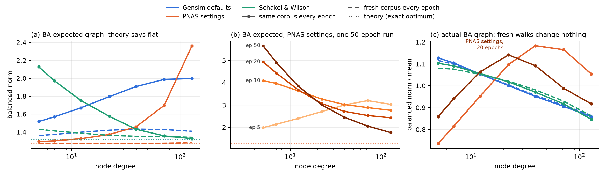

# Norm–degree curve as a moving front of an unfinished fit

Exploratory diagnosis of the Fig. 1 curves (2026-11-21), prompted by the question of why the three settings give rising, humped, and falling norm–degree curves.
Single seed, BA graphs only, with a numba reimplementation of Gensim's skip-gram update; treat it as a hypothesis with supporting evidence.

## Hypothesis

How fast a node's vector moves is set by how many updates it gets (degree × contexts per token × epochs × learning rate).
How far it has to go is set by how specific its context distribution is, which decreases with degree.
Early in training, norms follow speed and rise with degree; later, they follow distance and fall.
The peak marks the front between fitted and unfitted nodes, and it should move to lower degree with more training.
PNAS settings (window 1, 5 epochs) give the fewest updates per token and rise; Gensim defaults hump; Schakel & Wilson (window 10, 20 epochs) give the most and fall.

## BA expected graph (Fig. 1d)

Tokens are iid draws proportional to degree, so the population optimum is rank-1 and center norms are flat (theory 1.269 for PNAS, 1.313 for defaults).
The only node-specific signal is sampling noise in the finite corpus that is reused every epoch.

- After epoch 1, PNAS-setting norms sit flat at the theory value (1.27). Degree dependence appears from epoch 2, when the corpus is reused.
- A fresh iid corpus each epoch keeps all three settings nearly flat at 5 epochs: PNAS 1.269–1.279, defaults 1.36–1.43, Schakel & Wilson 1.43→1.34 (2.13→1.33 with the reused corpus).
- Shuffling sentence order each epoch leaves the excess in place, so the multiset of pairs drives it.
- The learned residual (W Cᵀ minus its leading mode) aligns with the top-50 singular vectors of D = N_pairs − n qᵀ, the corpus's pair counts minus their expectation: overlap 0.668 with the reused corpus, 0.077 with a fresh corpus, 0.005 for random subspaces. Row energy of D's top modes rises about 400× from degree 5 to 129, so hubs pick up the noise first.
- PNAS settings over 50 epochs: the curve rises and humps at epoch 5 (peak near degree 72), falls 4.09→2.76 by epoch 10, and falls 5.66→1.77 by epoch 50.
- With a fresh corpus over 20 epochs, PNAS settings show only a mild hump (1.40→1.51→1.46), so pure SGD noise is a small secondary effect.

So SGNS fits the particular corpus, sampling noise included, and the population theory line describes the fresh-corpus case.

## Actual BA graph

- Reused and fresh walks give identical curves for all three settings; graph structure dominates corpus noise here.
- PNAS settings give an inverted U (norm/mean 4.84→7.79 at degree ~39→6.94), already formed at epoch 1. Defaults and Schakel & Wilson only fall.
- Defaults with window 1 match PNAS settings at d=100, so window is the setting that matters. Defaults at d=300 still fall.
- Dimension: d=30 peaks in the top bin (72), d=100 peaks at 72, d=300 and d=1000 are identical (peak 39).
- PNAS settings over 20 epochs move the peak from degree 39 to 22.

This fits the constant-rate runs in `training_trajectory_findings.md`: at 0.0025 the epoch-20 curves still rise across all bins, consistent with less progress along the same path.

A truncated SVD of the window-1 NetMF target on the same graph only rises with degree at every rank (`netmf.py`), so NetMF is a poor stand-in here; it ignores the negative scores.

## Caveats

- The reimplementation (`scripts/norm_front/sgns.py`) matches Gensim within about 0.01 per bin for Schakel & Wilson at epoch 20. For PNAS settings at epoch 5 it gives 1.29→2.36 against Gensim's 1.31→3.0 (2.66 with shuffling); for defaults, 1.52→2.00 against 1.60→1.89→1.81. The size of the PNAS-setting excess is sensitive to implementation details.
- One seed, N=10,000, BA graphs only. BlogCatalog and text are untested.
- Whether the settings' peaks in Fig. 1b and 1c fall in the same order is unchecked.
- At window 1 the SGNS target is unbounded, so the "distance to go" is heuristic there.

## Possible tests

- A fresh-walks-per-epoch control for the network panels.
- One setting's curve at several epochs, to show the peak moving.
- Norm against cumulative updates per node (saved as `nupd_e` and `eta2_e`). If the hypothesis holds, the three settings' peaks should line up.

## Reproduction

`scripts/norm_front/run_all.sh` reruns every configuration above, redraws the figure, and prints the comparison and overlap numbers.
Per-run outputs go to `results/norm_front/runs/` (gitignored).
The scripts carry inline `uv` dependencies; the main `.venv` is not needed.
